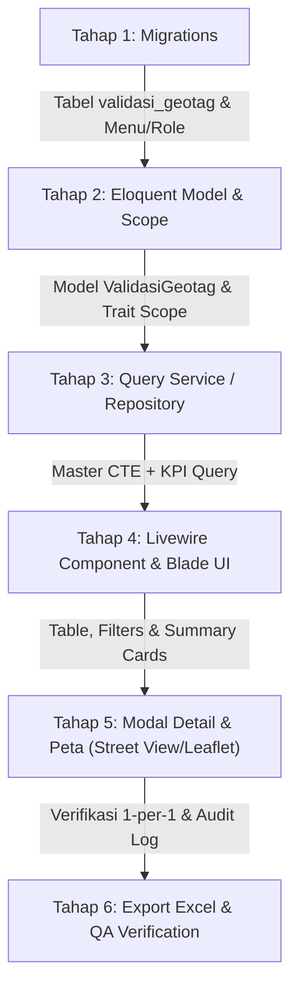

# Dokumen Master Perancangan & Spesifikasi Teknis (Fixed Blueprint)
# Modul Validasi Geotag Titik Koordinat Toko — Project Devsiso

> **Status Dokumen:** FINAL & DISESUAIKAN (Telah diselaraskan 100% dengan arsitektur, RBAC, dan Territory Scope project `devsiso`)  
> **Tanggal Pembaruan:** 22 Oktober 2026  
> **Target Module:** Backoffice Web Admin (`/others/validasi-geotag`)

---

## 1. Latar Belakang & 4 Anomali Lapangan

Modul ini dirancang untuk memverifikasi dan mengunci keabsahan titik koordinat toko fisik hasil survei/geotag salesman aplikasi Eskalink, guna menyelesaikan 4 anomali data lapangan:

1. **⚠️ Geotag Palsu di Kantor Distributor ($\le 100$ Meter)**:
   - Titik koordinat toko berada di dalam perimeter kantor/gudang distributor karena salesman melakukan geotag saat berada di depo, bukan saat kunjungan fisik ke toko.
   - Dideteksi secara matematis menggunakan rumus trigonometri **Haversine** di PostgreSQL terhadap koordinat gudang distributor (`master_distributors.latitude`, `master_distributors.longitude`).
2. **👥 Duplikasi Titik Massal (Clone Coordinate)**:
   - Koordinat `(la, lg)` yang sama persis digunakan berulang kali untuk puluhan hingga ratusan toko berbeda di cabang yang sama (indikasi copy-paste / tagging fiktif).
3. **📍 Toko Tanpa Koordinat**:
   - Toko yang aktif terdaftar dalam rute kunjungan mingguan salesman (`frute`), namun koordinatnya kosong, string kosong `''`, `NULL`, atau titik dummy (`0,0` / `1,1`).
4. **🔄 Pergeseran Titik Tak Terkendali (*Coordinate Drift*)**:
   - Toko yang statusnya sudah pernah disahkan sebagai `VALID` oleh verifikator, namun nilai koordinat di lapangan berubah karena tertimpa sinkronisasi data mobile baru.

---

## 2. Arsitektur Otorisasi & Hak Akses (RBAC) Project `devsiso`

Project `devsiso` menggunakan **Matrix Menu-Role & Access Group** kustom di atas Spatie Permission:

```
[User] ── hasRole ──> [Spatie Role] ── menu_role (pivot) ──> [Menu: others.validasi-geotag]
                                                                ├── can_view   (Lihat halaman & data)
                                                                ├── can_edit   (Aksi Validasi Toko)
                                                                └── can_export (Unduh Excel Rekap)
  │
  └── belongsTo ──> [Access Group: full_access] ── access_group_menu ──> Tampil di Sidebar Navigasi
```

### Aturan Hak Akses:
1. **Pengecekan Menu & Middleware**:
   - Route wajib diproteksi oleh middleware `'menu.access'` (`\App\Http\Middleware\CheckMenuAccess::class`).
   - Route Name resmi: **`others.validasi-geotag`**.
2. **Izin Aksi (Action Permission)**:
   - **Melihat Data & Metrik**: Memerlukan `$user->hasMenuAccess('others.validasi-geotag', 'can_view')`.
   - **Memvalidasi / Mengubah Status Toko**: Memerlukan `$user->hasMenuAccess('others.validasi-geotag', 'can_edit')`.
   - **Mengekspor Laporan**: Memerlukan `$user->hasMenuAccess('others.validasi-geotag', 'can_export')`.
   - **Role `admin`**: Selalu lolos semua otorisasi (Bypass via `User::hasMenuAccess()`).
3. **Pencatatan Audit Trail**:
   - Keputusan validasi mencatat identitas verifikator pada tabel `validasi_geotag`:
     - `validated_by` = `auth()->id()`
     - `validator_name` = `auth()->user()->name`
     - `validated_at` = `now()`

---

## 3. Arsitektur Cakupan Wilayah (Territory Scope) Project `devsiso`

Di project `devsiso`, batas wilayah user dikendalikan melalui fungsi otomatis di model `User`:
```php
$accessLevel = $user->getAccessLevel(); // 'nasional' | 'supervisor' | 'area' | 'region'
```

### Hirarki & Aturan Pencocokan Wilayah:

| Level Akses | Aturan di Model `User` | Cara Mapping ke Data Master Distributor & Cabang |
| :--- | :--- | :--- |
| **Nasional** | Role `admin`, `spm`, atau user HO (`region_code` memuat `'HOINA'`) | Bebas akses semua cabang/distributor (`WHERE 1 = 1`). |
| **Supervisor** | `!empty($user->supervisor_code)` | ⚠️ **PENTING:** `users.supervisor_code` adalah **`team_elite_code`** (bukan `siso_code`). Dihubungkan ke `master_distributors.supervisor_code` melalui tabel **`team_elite_code_mappings`** (`te.team_elite_code = :supervisor_code AND te.siso_code = md.supervisor_code`) ATAU view **`vw_distributor_hierarchy`**. |
| **Area** | `!empty($user->area_code)` (bertipe `array`) | Dibatasi ke area yang terdaftar: `md.area_code = ANY(:area_codes)`. |
| **Region** | `!empty($user->region_code)` (bertipe `array`) | Dibatasi ke region yang terdaftar: `md.region_code = ANY(:region_codes)`. |

### Hubungan Relasi Data Toko ke Distributor:
1. Base rute toko berasal dari `frute.kodecabang`.
2. `frute.kodecabang` adalah kode cabang Eskalink (`distributor_implementasi_eskalink.eskalink_code`).
3. `distributor_implementasi_eskalink.distributor_code` berelasi dengan `master_distributors.distributor_code`.
4. Tabel `master_distributors` menyimpan atribut wilayah: `region_code`, `area_code`, `supervisor_code` (`siso_code`), dan koordinat depo (`latitude`, `longitude`).

---

## 4. Spesifikasi Skema Database & Migrations

### A. Migration 1: Tabel Golden Record `validasi_geotag`

```php
<?php

use Illuminate\Database\Migrations\Migration;
use Illuminate\Database\Schema\Blueprint;
use Illuminate\Support\Facades\Schema;

return new class extends Migration {
    public function up(): void
    {
        if (!Schema::hasTable('validasi_geotag')) {
            Schema::create('validasi_geotag', function (Blueprint $table) {
                $table->id();
                $table->string('kodecabang', 50)->comment('Eskalink distributor code (frute.kodecabang)');
                $table->string('custno', 50)->comment('Customer code toko');
                $table->decimal('la', 11, 8)->nullable()->comment('Latitude sah hasil keputusan verifikator');
                $table->decimal('lg', 11, 8)->nullable()->comment('Longitude sah hasil keputusan verifikator');
                $table->string('status', 20)->comment('VALID atau TIDAK_VALID');
                $table->text('catatan')->nullable()->comment('Alasan/keterangan verifikator');
                $table->unsignedBigInteger('validated_by')->nullable()->comment('User ID verifikator');
                $table->string('validator_name', 150)->nullable()->comment('Nama verifikator saat validasi');
                $table->timestamp('validated_at')->nullable()->comment('Waktu keputusan validasi diambil');
                $table->timestamps();

                // Composite Unique Constraint: 1 toko di 1 cabang hanya punya 1 status validasi sah
                $table->unique(['kodecabang', 'custno'], 'uq_validasi_geotag_toko');

                // Performance Indexes
                $table->index('status', 'idx_validasi_geotag_status');
                $table->index('kodecabang', 'idx_validasi_geotag_kodecabang');
                $table->index('validated_at', 'idx_validasi_geotag_validated_at');
            });
        }
    }

    public function down(): void
    {
        Schema::dropIfExists('validasi_geotag');
    }
};
```

### B. Migration 2: Pendaftaran Menu, RBAC Pivot, & Access Group

```php
<?php

use Illuminate\Database\Migrations\Migration;
use Illuminate\Support\Facades\DB;

return new class extends Migration {
    public function up(): void
    {
        $existing = DB::table('menus')->where('route', 'others.validasi-geotag')->first();
        if (!$existing) {
            // Tempatkan di bawah menu group 'Others' (id: 76)
            $parentId = DB::table('menus')->where('name', 'Others')->value('id') ?? 76;

            $menuId = DB::table('menus')->insertGetId([
                'name' => 'Validasi Geotag Toko',
                'route' => 'others.validasi-geotag',
                'icon' => 'ri-map-pin-user-line',
                'parent_id' => $parentId,
                'order_number' => 16,
                'is_active' => true,
                'created_at' => now(),
                'updated_at' => now(),
            ]);

            // 1. Berikan permission ke role 'admin' & 'spm' (Full Access: View, Edit, Export)
            $roles = DB::table('roles')->whereIn('name', ['admin', 'spm'])->get();
            foreach ($roles as $role) {
                DB::table('menu_role')->insert([
                    'menu_id' => $menuId,
                    'role_id' => $role->id,
                    'can_view' => true,
                    'can_edit' => true,
                    'can_import' => false,
                    'can_export' => true,
                    'can_add' => false,
                    'can_delete' => false,
                    'created_at' => now(),
                    'updated_at' => now(),
                ]);
            }

            // 2. Tampilkan di Access Group 'full_access' untuk sidebar
            $fullGroup = DB::table('access_groups')->where('name', 'full_access')->first();
            if ($fullGroup) {
                DB::table('access_group_menu')->insert([
                    'access_group_id' => $fullGroup->id,
                    'menu_id' => $menuId,
                    'created_at' => now(),
                    'updated_at' => now(),
                ]);
            }
        }
    }

    public function down(): void
    {
        $menu = DB::table('menus')->where('route', 'others.validasi-geotag')->first();
        if ($menu) {
            DB::table('menu_role')->where('menu_id', $menu->id)->delete();
            DB::table('access_group_menu')->where('menu_id', $menu->id)->delete();
            DB::table('menus')->where('id', $menu->id)->delete();
        }
    }
};
```

---

## 5. Master PostgreSQL CTE Query (Dengan Injeksi Territory Scope)

Query ini memproses seluruh populasi toko aktif rute, menghitung jarak Haversine ke gudang distributor, mendeteksi duplikat per cabang, mengecek drift koordinat, dan menyaring wilayah user secara otomatis:

```sql
WITH base_rute AS (
    -- 1. Base List Toko Aktif Rute pada Distributor Eskalink Aktif
    SELECT DISTINCT
        f.kodecabang,
        f.custno
    FROM frute f
    JOIN distributor_implementasi_eskalink die 
        ON f.kodecabang = die.eskalink_code 
    JOIN master_distributors md 
        ON md.distributor_code = die.distributor_code 
    LEFT JOIN team_elite_code_mappings te 
        ON te.siso_code = md.supervisor_code
    WHERE md.is_active IS TRUE

      /* ========================================================== */
      /* A. INJEKSI USER TERRITORY SCOPE (Berdasarkan Level Akses)  */
      /* ========================================================== */
      AND (
          -- Level Nasional (admin, spm, atau user HOINA)
          :user_access_level = 'nasional'
          
          -- Level Supervisor: Cocokkan users.supervisor_code ke team_elite_code
          OR (:user_access_level = 'supervisor' AND te.team_elite_code = :user_supervisor_code)
          
          -- Level Area: Cocokkan ke array area_code milik user
          OR (:user_access_level = 'area' AND md.area_code = ANY(:user_area_codes))
          
          -- Level Region: Cocokkan ke array region_code milik user
          OR (:user_access_level = 'region' AND md.region_code = ANY(:user_region_codes))
      )

      /* ========================================================== */
      /* B. INJEKSI FILTER PILIHAN DROPDOWN UI                      */
      /* ========================================================== */
      AND (:filter_region IS NULL OR md.region_code = :filter_region)
      AND (:filter_area IS NULL OR md.area_code = :filter_area)
      AND (:filter_distributor IS NULL OR die.eskalink_code = :filter_distributor)
),
latest_customer AS (
    -- 2. Ambil Snapshot Teraktual Customer (Deduplikasi via DISTINCT ON)
    SELECT DISTINCT ON (cpe.kodecabang, cpe.custno)
        cpe.kodecabang,
        cpe.custno,
        cpe.custname,
        cpe.custadd1,
        cpe.ccity,
        cpe.typeout,
        cpe.grupout,
        NULLIF(TRIM(cpe.la), '') AS la_raw,
        NULLIF(TRIM(cpe.lg), '') AS lg_raw
    FROM customer_prc_eska cpe
    JOIN base_rute br 
        ON br.kodecabang = cpe.kodecabang 
       AND br.custno = cpe.custno
    ORDER BY cpe.kodecabang, cpe.custno, cpe.bln DESC NULLS LAST, cpe.id DESC
),
parsed_customer AS (
    -- 3. Sanitasi & Parsing Koordinat Numerik
    SELECT 
        lc.*,
        CASE 
            WHEN lc.la_raw ~ '^-?[0-9]+(\.[0-9]+)?$' THEN lc.la_raw::numeric 
            ELSE NULL 
        END AS la_clean,
        CASE 
            WHEN lc.lg_raw ~ '^-?[0-9]+(\.[0-9]+)?$' THEN lc.lg_raw::numeric 
            ELSE NULL 
        END AS lg_clean
    FROM latest_customer lc
),
duplicate_counts AS (
    -- 4. Deteksi Duplikat Koordinat Khusus di Cabang yang Sama
    SELECT 
        kodecabang,
        ROUND(la_clean, 6) AS la_round,
        ROUND(lg_clean, 6) AS lg_round,
        COUNT(*) AS total_duplicate_stores
    FROM parsed_customer
    WHERE la_clean IS NOT NULL AND lg_clean IS NOT NULL
      AND NOT (la_clean = 0 AND lg_clean = 0)
      AND NOT (la_clean = 1 AND lg_clean = 1)
    GROUP BY kodecabang, ROUND(la_clean, 6), ROUND(lg_clean, 6)
    HAVING COUNT(*) > 1
)
SELECT 
    b.kodecabang,
    b.custno,
    COALESCE(c.custname, '-') AS custname,
    COALESCE(c.custadd1, '-') AS custadd1,
    COALESCE(c.ccity, '-') AS ccity,
    c.typeout,
    c.grupout,
    c.la_clean AS la,
    c.lg_clean AS lg,
    md.latitude AS dist_latitude,
    md.longitude AS dist_longitude,
    md.distributor_name,
    md.branch_name,
    md.region_name,
    md.area_name,
    
    vg.status AS validation_status,
    vg.catatan AS validation_notes,
    vg.la AS validated_la,
    vg.lg AS validated_lg,
    vg.validator_name,
    vg.validated_at,

    -- Kalkulasi Jarak Haversine ke Gudang Distributor (dalam Meter)
    CASE 
        WHEN c.la_clean IS NOT NULL AND c.lg_clean IS NOT NULL 
         AND md.latitude IS NOT NULL AND md.longitude IS NOT NULL THEN
            ROUND((6371000 * acos(
                LEAST(1.0, GREATEST(-1.0,
                    cos(radians(md.latitude)) * cos(radians(c.la_clean)) *
                    cos(radians(c.lg_clean) - radians(md.longitude)) +
                    sin(radians(md.latitude)) * sin(radians(c.la_clean))
                ))
            ))::numeric, 1)
        ELSE NULL 
    END AS distance_to_dist_meters,

    -- Flag Anomali 1: Titik di Distributor (<= 100 Meter)
    CASE 
        WHEN c.la_clean IS NOT NULL AND c.lg_clean IS NOT NULL 
         AND md.latitude IS NOT NULL AND md.longitude IS NOT NULL
         AND (6371000 * acos(
                LEAST(1.0, GREATEST(-1.0,
                    cos(radians(md.latitude)) * cos(radians(c.la_clean)) *
                    cos(radians(c.lg_clean) - radians(md.longitude)) +
                    sin(radians(md.latitude)) * sin(radians(c.la_clean))
                ))
             )) <= 100 THEN true 
        ELSE false 
    END AS is_at_distributor,

    -- Flag Anomali 2: Duplikasi Titik di Cabang Sama
    COALESCE(dup.total_duplicate_stores, 0) AS duplicate_count,

    -- Flag Anomali 3: Titik Berubah (Drift vs Titik Tervalidasi)
    CASE 
        WHEN vg.status = 'VALID' 
         AND (ROUND(vg.la, 6) != ROUND(c.la_clean, 6) OR ROUND(vg.lg, 6) != ROUND(c.lg_clean, 6)) THEN true 
        ELSE false 
    END AS is_point_changed,

    -- Flag Anomali 4: Belum Ada Titik / Dummy Coordinate
    CASE 
        WHEN c.la_clean IS NULL OR c.lg_clean IS NULL 
          OR (c.la_clean = 0 AND c.lg_clean = 0)
          OR (c.la_clean = 1 AND c.lg_clean = 1) THEN true 
        ELSE false 
    END AS is_missing_coordinate

FROM base_rute b
LEFT JOIN parsed_customer c 
    ON c.kodecabang = b.kodecabang 
   AND c.custno = b.custno
LEFT JOIN distributor_implementasi_eskalink die 
    ON die.eskalink_code = b.kodecabang
LEFT JOIN master_distributors md 
    ON md.distributor_code = die.distributor_code
LEFT JOIN duplicate_counts dup 
    ON dup.kodecabang = c.kodecabang 
   AND dup.la_round = ROUND(c.la_clean, 6) 
   AND dup.lg_round = ROUND(c.lg_clean, 6)
LEFT JOIN validasi_geotag vg 
    ON vg.kodecabang = b.kodecabang 
   AND vg.custno = b.custno;
```

---

## 6. Spesifikasi Antarmuka & UX (Livewire 3 + Blade + Leaflet)

Sesuai standar backoffice desktop project `devsiso`, modul ini dibangun menggunakan **Livewire 3 Component** (`App\Livewire\Others\ValidasiGeotag\Index`) dengan layout utama `layouts.app`.

### A. 4 Consolidated Summary Cards (KPI Metrik Atas)
1. **Card 1 (Populasi & Progres)**:
   - Total Toko Aktif Rute vs Belum Divalidasi (`%` antrean sisa).
2. **Card 2 (Hasil Validasi)**:
   - Toko Valid (Badge Hijau) vs Tidak Valid (Badge Merah).
3. **Card 3 (Kelengkapan Koordinat)**:
   - Toko Memiliki Titik vs Belum Memiliki Titik (Null/Dummy).
4. **Card 4 (Pusat Peringatan & Aksi Anomali)**:
   - Akumulasi toko dengan anomali:
     - ⚠️ Jarak $\le 100$ meter ke Depo
     - 👥 Duplikat Titik di Cabang
     - 🔄 Titik Berubah (*Drift*)

### B. Bar Filter Dinamis
- Dropdown **Region** (otomatis terkunci sesuai hak user).
- Dropdown **Area** (otomatis terkunci sesuai hak user).
- Dropdown **Distributor / Cabang** (berdasarkan distributor yang dinaungi).
- Dropdown **Status Anomali**: *Semua*, *Titik di Depo*, *Titik Duplikat*, *Titik Berubah*, *Tanpa Koordinat*.
- Dropdown **Status Validasi**: *Semua*, *Belum Divalidasi*, *Valid*, *Tidak Valid*.
- Kotak Pencarian (`Search` Nama Toko / Custno / Alamat).

### C. Modal Verifikasi Manual 1-per-1 (No Bulk Action)
- Tidak ada fitur centang massal (*bulk approval*) demi menjamin validitas data.
- Setiap baris memiliki tombol **[Detail]** yang memicu modal interaktif:
  1. **Tab Street View**:
     - Embed Google Street View via iframe resmi:
       `https://www.google.com/maps?layer=c&cbll={la},{lg}&output=svembed`
  2. **Tab Peta Satelit**:
     - Embed Google Maps Satellite:
       `https://maps.google.com/maps?q={la},{lg}&t=k&z=19&output=embed`
  3. **Peta Interaktif Leaflet (Lokal via Base Maps CARTO)**:
     - Tile layer CARTO Voyager dengan API Key (`CARTO_API_KEY`):
       `https://{s}.basemaps.cartocdn.com/rastertiles/voyager/{z}/{x}/{y}{r}.png?key={CARTO_KEY}`
     - Menampilkan 2 marker sekaligus:
       - Marker Biru: Titik Toko Lapangan.
       - Marker Merah: Titik Gudang Distributor dengan lingkaran radius merah $100$ meter (visualisasi instan bila geotag palsu di kantor).
  4. **Pintasan Cepat**:
     - Tombol eksternal **"Buka di Google Maps"** (`https://www.google.com/maps/search/?api=1&query={la},{lg}`) jika ingin navigasi di tab baru.
  5. **Panel Form Eksekusi Keputusan**:
     - Tombol **[Setujui - VALID]** (Warna Hijau).
     - Tombol **[Tolak - TIDAK VALID]** (Warna Merah).
     - Tombol **[Kembalikan ke Titik Sah]** (Muncul khusus jika anomali *Coordinate Drift* terdeteksi).
     - Input textarea **Catatan Verifikator** (opsional/wajib jika tolak).

---

## 7. Action Plan & Tahapan Eksekusi



1. **Tahap 1 — Database Migrations**:
   - Jalankan migration pembuatan tabel `validasi_geotag`.
   - Jalankan migration pendaftaran menu `others.validasi-geotag`, hak role `menu_role`, dan grup `access_group_menu`.
2. **Tahap 2 — Eloquent Model & Scopes**:
   - Buat model `App\Models\ValidasiGeotag.php`.
   - Buat helper method `scopeForUserAccess($query, $user)` dengan pola `vw_distributor_hierarchy` & `team_elite_code_mappings`.
3. **Tahap 3 — Query Service**:
   - Buat service `App\Services\ValidasiGeotagService.php` untuk membungkus query CTE PostgreSQL yang teroptimasi, pagination, dan kalkulasi kartu KPI.
4. **Tahap 4 — Livewire Component & UI**:
   - Buat `App\Livewire\Others\ValidasiGeotag\Index.php` dengan trait `EnforcesMenuPermissions`.
   - Buat blade template `resources/views/livewire/others/validasi-geotag/index.blade.php`.
5. **Tahap 5 — Modal Verifikasi**:
   - Implementasikan modal Alpine.js / Livewire dengan tab switcher Google Street View, Satellite, dan Leaflet Map.
6. **Tahap 6 — Ekspor & Testing**:
   - Buat export class Excel menggunakan format Maatwebsite/FastExcel jika diperlukan laporan rekap.
   - Uji verifikasi hak akses multi-role: Admin, SPM, Supervisor, Area Manager, Region Manager.
